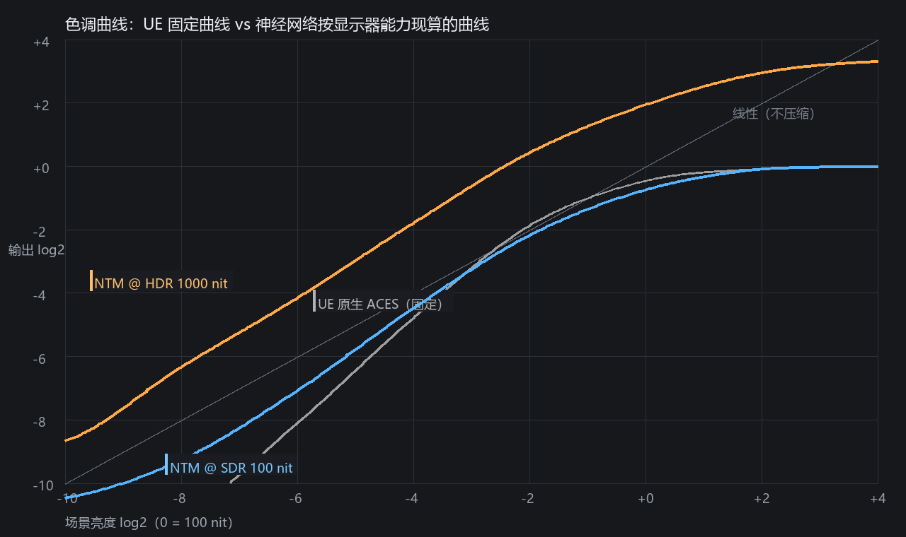

# NTM — Neural Tone Mapper（神经网络动态色调映射）

> 一个 Unreal Engine 5.8 插件：**用一个 327K 参数的神经网络，每帧重算色调映射曲线**，
> 并根据你的**显示器实际亮度能力**自动调整。
>
> 曲线不是查表查出来的，是算出来的；算完再烘焙成 33³ LUT 给每个像素采样。开销约 **0 毫秒**。

[](https://www.unrealengine.com)
[]()
[]()
[]()
[](LICENSE)



> 三种曲线画在同一张图上：**灰**是 UE 原生 ACES（固定不变），**蓝**是 NTM 在 SDR 100 nit 屏上的输出，
> **橙**是 NTM 在 1000 nit HDR 屏上的输出。同一个网络、同一份权重，只因为显示器能力不同，
> 曲线就完全不同 —— 这就是"硬件自适应"最直接的证据。
> 生成这张图的脚本在 [`dev/training/plot_curves.py`](dev/training/plot_curves.py)。

---

## 目录

- [一、十分钟看懂](#一十分钟看懂)
- [二、实现原理](#二实现原理)
  - [2.0 为什么不用 UE 自带的曲线](#20-为什么不用-ue-自带的曲线)
- [三、神经网络是怎么决定 tonemapper 的](#三神经网络是怎么决定-tonemapper-的)
- [四、LUT 表](#四lut-表)
- [五、tonemapper 的更新与控制方案](#五tonemapper-的更新与控制方案)
- [六、训练方案](#六训练方案)
- [七、神经权重结果](#七神经权重结果)
- [八、复现](#八复现)
- [九、实测数据](#九实测数据)
- [十、安装与使用](#十安装与使用)
- [十一、已知限制](#十一已知限制)
- [十二、版本历史](#十二版本历史)

---

## 一、十分钟看懂

| 问题 | 传统做法 | NTM |
|---|---|---|
| 用什么色调曲线 | 一条固定的 ACES，写死在引擎里 | 每帧由神经网络现算 |
| 看内容吗 | 不看。昏暗室内和雪地一视同仁 | 看。输入画面缩略图 + 亮度分布 |
| 看显示器吗 | 基本不看。HDR 屏的亮度范围大半用不上 | 看。读真实 EDID，峰值/ABL/编码全进网络 |
| 每像素成本 | 一次 LUT 采样 | 一次 LUT 采样（**一样**） |
| 开销 | 基准 | **约 0 毫秒** |

**一句话：换掉的不是 LUT，而是"谁来决定 LUT 的内容"。**

| 说法 | 对不对 |
|---|---|
| 神经网络**替代了 LUT** | ❌ LUT 还在，还是每像素查一次 |
| 神经网络**替代了那条写死的 ACES 曲线** | ✅ |
| 神经网络**每帧决定 LUT 的内容** | ✅ 这才是准确描述 |

---

## 二、实现原理

### 2.0 为什么不用 UE 自带的曲线

Unreal 用的是 **ACES 家族**的固定曲线，质量很好，但有两个根本限制：

**限制 1：不管玩家和用户硬件的区别**

无论显示器是 100 nit 的办公屏还是 1600 nit 的 HDR 电视，UE 用的都是同一条曲线。
在 HDR 屏上曲线压得太保守，花大价钱买的亮度范围大半没用上；在低亮度屏上又压得不够，高光糊成一片。

**限制 2：不看画面表现内容**

一条固定曲线，对"昏暗的室内"和"烈日下的雪地"一视同仁。但这两者需要的压缩策略完全不同：
雪地要保住高光层次，室内要保住暗部细节。UE 靠自动曝光缓解了一部分，但**曝光只调整体亮度，
不改变曲线的形状**。

**我们做的事**：把那条固定曲线，换成每帧由神经网络根据「画面长什么样」+「你的屏幕能多亮」现算的一条。
### 2.1 色调映射要解决什么

真实世界的光照范围极大，太阳下的地面可能是阴影里的一万倍。屏幕是有上限的：SDR 大约 100–300 nit，
HDR 屏 1000–2000 nit。所以每帧都要把"无限的亮度"压进"屏幕能显示的范围"。

不能简单相除 —— 除完亮部全糊成白、暗部全压成黑。真实做法是一条曲线：暗部尽量保留、中段基本不变、
亮部平滑地压向屏幕峰值。

**不同的曲线 = 不同的画面风格**，这就是为什么各家引擎都有自己的曲线。

### 2.2 我们的做法：三段式

```
     每一帧
        │
 ┌──────▼─────────────────────────────────────────┐
 │ ① 特征提取  画面 → 49×72×128 张量               │  ~0.05 ms
 └──────┬─────────────────────────────────────────┘
        │
 ┌──────▼─────────────────────────────────────────┐
 │ ② 神经网络  49×72×128 → 72 个数                 │  ~0.2 ms（每 4 帧一次）
 │    其中 8 个 = 曲线控制点，64 个 = 局部强度      │
 └──────┬─────────────────────────────────────────┘
        │
 ┌──────▼─────────────────────────────────────────┐
 │ ③ 烘焙 LUT  8 个控制点 → 33³ 查找表             │  ~0.1 ms
 └──────┬─────────────────────────────────────────┘
        │
   每个像素：查一次表                                 1 次纹理采样
```

**关键点**：重活（②③）不是每帧都做，逐像素的部分只是一次查表。这是能做到"开销接近 0"的全部原因。

---

## 三、神经网络是怎么决定 tonemapper 的

### 3.1 输入：49 通道张量

网络看到的不是完整画面，是一张 **128×72 的缩略图 + 45 个统计量**，拼成 49 通道：

| 通道 | 内容 | 为什么需要 |
|---|---|---|
| 0–2 | PQ 编码的 RGB 缩略图 | 画面长什么样 |
| **3** | **边缘强度（Sobel）** | 知道哪里有强明暗边界，决定局部过滤能推到多强而不出光晕 |
| 4 | 全画面 log2 平均亮度 | 整体曝光水平 |
| 5 | log2 p99.99 亮度 | 有没有极端高光 |
| 6–16 | **显示与场景标量（11 个）** | 见 3.5：面板峰值、ABL、纸张白、编码、色域、SDR/HDR 标志…… |
| 17–32 | 4×4 分块 log2 亮度 | 明暗**分布**（天空在上还是在下） |
| 33–48 | 16 档 log2 亮度直方图 | 多少像素在暗部、多少在亮部 |

> 通道 0–2 用 **PQ（ST-2084）** 而不是线性或 gamma 编码，是因为 PQ 在暗部和亮部的相对精度都够，
> 8 bit 就能覆盖 10000:1 的范围。用线性编码会让暗部全变成 0。

### 3.2 网络结构

```
输入 [1, 49, 72, 128]
   │
   ├─ 图像分支：4 层卷积（stride 2）→ 全局池化 → 128 维
   │
   └─ 上下文分支：45 个标量 → 全连接 → 128 维
                    │
                    ▼  相加（不用 Concat，见 4.4）
              LayerNorm → 128 维
                    │
        ┌───────────┴───────────┐
        │                       │
   曲线头                     局部参数头
   8 个输出                   64 个输出
```

总计 **326.6K 参数**，ONNX 文件 **1.3 MB**。没有注意力、没有 Transformer —— 输入只有 72×128，
卷积足够，参数量也压在论文提到的数量级（292K）。

> **为什么不用 Concat 拼输出**：UE 的 `NNERuntimeRDGHlsl` 后端不支持 `Concat` 算子
> （`Pad` 也会被降级成 Concat）。所以 8 + 64 个输出用一个 **0/1 放置矩阵 + MatMul** 拼起来，
> 效果完全等价。导出脚本会把算子表打出来，出现 Concat 就判定 `DEPLOYABLE=False`。

### 3.3 输出：8 个控制点，且数学上必然单调

网络输出的 8 个数是曲线在 8 个固定输入位置的**输出**（log2 亮度）：

```
输出 log2
  +4 ┤                                    ●   ← 第 8 点
  +2 ┤                            ●
   0 ┤                    ●
  -2 ┤              ●
  -4 ┤        ●
  -6 ┤    ●
  -8 ┤  ●
    └──┬────┬────┬────┬────┬────┬────┬───→ 输入 log2
      -10  -8   -6   -4   -2   0   +2  +4
```

**如果两个点的顺序颠倒，画面会出现对比度反转**（亮的地方变暗），所以单调性不是"最好有"，而是硬要求。

因此输出层不是普通线性层，而是这样构造的：

```
第 8 点    = 起点 + 跨度 × sigmoid(z_span)
中间 7 段  = softmax(7 个 logit)      ← 7 段占比之和恒为 1
每个点     = 起点 + 跨度 × 前缀和
```

数学上**保证**严格递增，不需要事后排序或修补。softmax 还加了**下限**（floor）：
纯 softmax 在 logit 很大时会饱和成 one-hot，让相邻两点重合，悄悄破坏严格单调 —— 加下限就不会。

### 3.4 曲线求值：单调三次插值

8 个点之间用 **Fritsch-Carlson 单调三次插值**（`NTMO_EvalCurveLog2`），不是线性也不是普通 Catmull-Rom：

- 普通三次样条会过冲（overshoot），在陡峭段产生**局部反向**，画面出现暗环或亮环
- Fritsch-Carlson 会限制切线斜率，保证插值结果**在点之间也单调**

这样即使网络某次输出了很奇怪的 8 个点，画面也只会"变暗/变亮"，不会出现对比度反转。

### 3.5 硬件自适应是怎么进网络的

每 0.5 秒读一次显示器的**真实 EDID**（`HDRGetMetaDataForWindow`）：

| 读到的参数 | 影响 |
|---|---|
| 面板峰值亮度 `MaximumLuminanceInNits` | 曲线最高点能到哪 |
| **全屏全白峰值** `MaximumFullFrameLuminanceInNits` | 见下方 ABL 说明 |
| 黑位 `MinimumLuminanceInNits` | 曲线最低点 |
| 纸张白 `HDRPaperWhiteInNits` | SDR 白在 HDR 下的对应亮度 |
| 输出编码 `DisplayOutputFormat` | 最终输出用 sRGB/PQ/scRGB 哪种 |
| 色域 `DisplayColorGamut` | 饱和度处理 |
| 是否 HDR | 是否启用 ABL 感知 |

这些全部变成输入通道 6–16。**ABL 是这里最容易忽略的一点** —— 很多 HDR 屏标称 1000 nit，
但全屏显示白色时会自动降到 300–400 nit（自动亮度限制），否则过热或烧屏。只按 1000 nit 做映射的话，
明亮大场景里画面会被屏本身压暗，用户会觉得"怎么调都不亮"。所以**峰值和全屏峰值都喂给网络**。

实测（同一个网络、同一帧画面，只改显示器上下文）：

| 显示器上下文 | 网络输出的曲线峰值 |
|---|---|
| SDR 100 nit，ABL 1.00 | **100 nit**（`knot[7] = 0.0002`） |
| HDR 1000 nit，全屏 400 nit，ABL 0.40 | **约 430 nit** |
| HDR 1000 nit（数据集里的正常样本） | **1000 nit**（`knot[7] = 3.322`） |

峰值精确跟踪了 ABL 限制后的全屏亮度。数据集里还能看到网络预测到 **4600 nit** 的样本 ——
那是 4000 nit 面板的上下文，说明它确实在按显示器能力缩放，而不是学了个固定值。

**EDID 读不到时**（投影机、采集卡、虚拟屏、转换器）退回引擎 cvar，再不行按 100 nit SDR 处理；
也可以手动覆盖：

```
Project Settings → Plugins → Neural Tone Mapper
  Override Display Metadata  ✔
  Override Peak Nits         1000
  Override Full Frame Nits   400
  Override Output Device     3   (3 = PQ / ST.2084)
```

---

## 四、LUT 表

### 4.1 为什么还需要 LUT

曲线确定后，理论上每个像素都要算一次"场景亮度 → 曲线 → 屏幕亮度"。4K 有 830 万像素，
每像素算一条三次曲线太浪费。

所以：**先把曲线烘焙成一张 3D 查找表（33×33×33）**，运行时每像素只做一次三线性采样。

```
每 4 帧：
   神经网络 → 8 个控制点 → 曲线 → 烘焙 33³ LUT（约 3.6 万个格子）

每个像素：
   查一次表
```

**为什么 33³ 就够**：整个色调映射是输入的平滑函数（曲线 + 最大通道比值），
相邻格子之间三线性插值误差很小。UE 自己的 color grading LUT 也是这个尺寸。

### 4.2 LUT 里存的是什么

这是本实现和"教科书 LUT"不同的地方，值得单独说明：

| 项 | 值 | 原因 |
|---|---|---|
| 网格索引 | **PQ（ST-2084）空间** | 用线性索引的话，10000:1 范围内 33 个格子会把暗部糊死；PQ 索引让暗部也有足够分辨率 |
| 存的数值 | **线性显示值，不是编码值** | 局部校正要在显示域做乘性 `exp2()`，作用在 PQ 编码值上是错的（PQ 对亮度非线性）。编码被移到 tonemap 像素着色器的最后一步 |
| 曝光 | **烘焙时折叠进去** | 烘焙时计算 `ToneMap(grid * Exposure)`，运行时就能直接拿曝光后的场景色去采样 |
| 每格内容 | 完整色调映射在那一格的结果 | 所以运行时是纯粹的一次纹理采样，没有额外数学 |

色调映射本身是 **MaxRGB 色相保持**形式：只从最亮通道算一个标量比值，再统一乘到 RGB 上。
逐通道上曲线会改变色相，这正是 ACES 那套"notorious six"色偏的根源。

### 4.3 最终 LUT 在哪

三个地方，任取其一：

**① 运行时自动生成** —— 插件每帧烘焙，你不需要做任何事

**② 直接下载 .cube 文件**（给外部工具 / 离线检查用）

| 文件 | 说明 |
|---|---|
| [`dev/lut/NTMO_SDR_100nit_33.cube`](dev/lut/NTMO_SDR_100nit_33.cube) | 100 nit 面板，曲线峰值 100 nit |
| [`dev/lut/NTMO_HDR_1000nit_33.cube`](dev/lut/NTMO_HDR_1000nit_33.cube) | 1000 nit 面板，曲线峰值 1000 nit |
| [`dev/lut/NTMO_LUT_manifest.json`](dev/lut/NTMO_LUT_manifest.json) | 两个 LUT 对应的 8 个控制点、来源样本、峰值换算 |

> ⚠️ 这两个 `.cube` 存的是**线性显示值**。消费方如果要的是编码后的值，
> 需要自己再套一次 sRGB/PQ。manifest 里也写了这条。

**③ 自己重新生成**

```powershell
.venv311\Scripts\python dev\training\export_lut.py `
    --onnx plugin\NeuralToneMapper\Content\Models\NTMO_M_v8.onnx `
    --shards .\shards_v3 --out .\lut --size 33
```

这个脚本是 `NTMOCommon.ush` + `NTMOLutBake.usf` 的**逐行 CPU 移植**：同样的 PQ 索引、
同样的 Fritsch-Carlson 曲线、同样的 MaxRGB 映射、同样的 60% 峰值起点的高光去饱和斜坡。
所以它算出来的 LUT 和 GPU 上烘焙的是同一个东西。

---

## 五、tonemapper 的更新与控制方案

### 5.1 怎么接管引擎的 tonemapper

UE 的后处理链有一个枚举值 `EPostProcessingPass::ReplacingTonemapper`。注册了这个后处理回调的插件，
会让引擎**跳过自己的 `AddCombineLUTPass` 和 `AddTonemapPass`**：

```cpp
void FNTMOSceneViewExtension::SubscribeToPostProcessingPass(
    EPostProcessingPass Pass, const FSceneView& View,
    FPostProcessingPassDelegateArray& InOutPassCallbacks, bool bIsPassEnabled)
{
    if (Pass != EPostProcessingPass::ReplacingTonemapper) return;
    // 注册我们的 pass，UE 自己的 tonemapper 不再执行
}
```

**不改引擎源码，纯插件。**

> 这里有一个致命陷阱：`IsActiveThisFrame()` 必须**直接读开关**，不能返回一个在
> `SetupViewFamily()` 里才赋值的缓存标志 —— 引擎会先用 `IsActiveThisFrame` 过滤，再分发 setup 钩子，
> 于是标志永远没被赋值，扩展永远不活跃，`AddPasses` 一次都没执行，画面和原生一模一样。
> 最早怀疑"插件没效果"就是这个原因。

### 5.2 一帧里的执行顺序

```
场景色（曝光已解析）
   │
   ├─ 亮度金字塔 G0(1/2) G1(1/4) G2(1/8) G3(1/16)，都是 log2 亮度
   ├─ 帧统计：4×4 分块 + 16 档直方图（uint 原子累加，HLSL 没有浮点原子操作）
   ├─ 组装 49 通道张量
   │
   ├─【神经网络推理】NNE 的 RDG 运行时直接发计算指令，CPU 不回读
   │     → 72 个 float 写入 GPU buffer
   │
   ├─ 时域平滑 EMA（半衰期 0.15 秒）
   ├─ 局部校正 pass → RG16F 校正图
   ├─ 烘焙 33³ LUT
   └─ 最终 pass：曝光 → 局部增益 → 查 LUT → 输出编码 → 抖动
```

> **pass 顺序不能错**：RDG 按 `AddPass` 的**调用顺序**追踪资源版本，读操作必须注册在写操作之后。
> 把统计 pass 挪到金字塔上方（1.0.3 干的）会让它读到一张还没被写过的纹理，
> RDG 校验直接失败并污染网络输入的 32 个通道 —— 这是 1.0.4 修的那个 bug。

### 5.3 更新频率与时域平滑

曲线是**慢变量**：画面内容变化再快，合适的色调曲线也不会突变。所以：

| 机制 | 值 | 效果 |
|---|---|---|
| 推理间隔 | 默认**每 4 帧**一次 | 30 Hz 更新，肉眼无法分辨；省下 0.85 ms |
| 曲线 EMA | 半衰期 **0.15 秒** | 防止曲线跳变造成的"呼吸感" |
| 复用上次结果 | 间隔帧直接 `RegisterExternalBuffer` 上一次的输出 | 那些帧完全没有额外 pass |

实测：间隔 1 帧是 +0.81 ms，间隔 4 帧是 **−0.04 ms**（比 UE 原生还略省），而画质差异在小数点后第四位。

### 5.4 局部校正：AI 的第二份输出

除了全局曲线，网络还输出 **4×4 网格 × 4 个通道 = 64 个局部参数**：

| 通道 | 作用 | 应用位置 |
|---|---|---|
| `s_base` | 基频非线性压缩 | 曲线**前** |
| `s_mid` / `s_high` | 粗/细频带细节 | 曲线**后** |
| `s_low` | **局部曝光**（暗区提亮） | 曲线**前** |

```
校正量 = s_low × clamp(局部亮度 − 帧均值, −3, +3) × 曝光强度     （曲线前，场景域）
       + s_mid × (G1 − G3) + s_high × (G0 − G1)                  （曲线后，显示域）
```

**为什么必须分两个域**：

- 局部曝光物理上就是场景亮度操作，放在曲线前才能被曲线陡峭的暗部放大
- 细节补偿必须放在曲线后，否则曲线会把它重新压回去

1.0.2 把两者都放在曲线后，结果"暗部没变化、亮部更明显" —— 那是这个设计缺陷造成的，
不是参数没调好。1.0.3 改成混合域，1.0.4 修正了统计顺序错误。

### 5.5 三层安全网

网络可能输出任何东西（模型坏了、喂了垃圾、契约不匹配）。所以有三层保护：

**① 物理钳制曲线** —— 曲线输出是亮度，不可能超过面板峰值，也不可能低于黑位：

```hlsl
K = clamp(K, log2(minNits/100), log2(maxNits/100))
```

min/max 保持单调性，所以最多把顶部压平 —— 那正好就是真实高光削顶的样子。

**② 单调插值** —— 即使控制点单调，普通三次插值也可能过冲。Fritsch-Carlson 保证点之间也单调。

**③ 硬上限** —— 局部校正的绝对值被 `LocalGainClampStops`（默认 1.5 档）截断。

### 5.6 降级路径

| 层级 | 开关 | 行为 |
|---|---|---|
| 正常 | — | AI 曲线 + AI 局部参数 |
| 关神经网络 | `r.NTMO.Neural 0` | 用解析曲线（兜底策略），局部参数用固定默认值 |
| 关局部校正 | `r.NTMO.Local 0` | 只做全局曲线映射 |
| 全关 | `r.NTMO.Enable 0` 或菜单取消勾选 | 交还 UE 原生 tonemapper，画面与未装插件完全一致 |

NNE 运行时不可用、模型文件缺失、契约不匹配时，会自动走上面第二条，**不会崩**。

---

## 六、训练方案

### 6.1 标签从哪来

没有"真人调色"的大规模数据集，所以用一个**教师集成**来生成标签：

```
8 条教师曲线（clip / Reinhard / Hable / UE-Uncharted / UE-HP / UE-Legacy / UE-ACES / 解析策略）
        │
        │  按场景类型概率加权混合（不是硬切换）
        ▼
   目标曲线 → 采样成 8 个控制点 → 这就是标签 y[0:8]
```

三个关键设计：

1. **概率加权混合，不是硬切换。** 硬切换会让标签在场景类型边界不连续，实测把可达 L1 卡在 1.0 左右
2. **按场景类型重加权。** 低调场景更信解析策略（保住暗部），高调场景更信 ACES，高光场景更信 Uncharted
3. **SDR 单独提权 filmic 曲线。** 最早一版在 SDR 下阴影偏亮 0.7 档，靠这个补回来

局部的 64 个参数用**最小二乘拟合** Durand 参考：

```
目标 = curve(base) + detail + 局部曝光项
在每个 4×4 tile 上解 4×4 最小二乘，回归量是
    c3 − c0                   （基频非线性压缩）
    G1 − G3                   （粗频带）
    G0 − G1                   （细频带）
    clamp(G3 − 帧均值, ±3)     （局部曝光）
```

三个频带差**刻意互不重叠**：如果把中间项写成 `(G0 − G3)`，它会与另外两项完全共线，矩阵奇异。

### 6.2 数据长什么样

每个样本三类数据：

| 字段 | 形状 | dtype | 内容 |
|---|---|---|---|
| `rgb_pq` | (4, 72, 128) | uint8 | PQ 编码 RGB + Sobel 边缘强度 |
| `ctx` | (45,) | float32 | 13 显示标量 + 16 分块 + 16 直方图 |
| `y` | (72,) | float32 | 8 曲线控制点 + 64 局部强度 |

**规模**：100,000 样本（25,000 张合成 HDR 图 × 4 种显示上下文），3.5 GB，单机 12 线程 **3 分钟**生成。

**生成器是确定性的**：固定种子 `12345 + i*7919`、固定 64 份作业、`imap` 有序收集。
同一条命令产出同样的字节，进程数只影响速度。这一点是刻意修的 —— 早期版本按进程数切分作业，
导致 8 核和 16 核机器生成的数据不一样，"clone 下来复现"会得到不同结果。

### 6.3 训练配置与踩过的坑

| 项 | 值 |
|---|---|
| 优化器 | AdamW + OneCycle |
| 批大小 | 256 |
| 从零训练 | lr 6e-4，45 分钟，1 epoch ≈ 1 分钟 |
| 冻结主干微调 | lr 4e-4，30 分钟（只训 64 个局部参数） |
| 损失 | 曲线 L1（权重 1.0）+ 局部 L1（权重 0.6） |
| 精度 | 训练 fp16 autocast，**评估强制 fp32** |

四个真实踩过的坑，都写在代码注释里：

| 现象 | 原因 | 解法 |
|---|---|---|
| 模型塌成常数（预测 std 0.001） | LayerNorm 后接 tanh 头会饱和 | 头前加 LayerNorm + 从显示上下文直接加一条线性通路 |
| val 在 0.79 / 11.7 之间剧烈跳 | fp16 下评估 | 评估固定 fp32 |
| 加局部头后曲线退化（0.32 → 0.54） | 局部损失占 72 个输出里的 64，把主干拖走 | `--freeze-backbone`，只训局部头 |
| 微调后指标反而变差 | lr 4e-4 把模型踢出好的盆地 | 微调压到 6e-5 ~ 8e-5 |

**冻结主干这一条是 1.0.3 的关键。** 加 64 维局部头后全网络一起训，曲线会退化；
只训局部头，曲线保持在 0.321，而局部参数相关性从 0.53 提到 **0.76**。

---

## 七、神经权重结果

三个已训练好的权重在 [`dev/checkpoints/`](dev/checkpoints/)：

| 文件 | 大小 | 产物 | 曲线 L1 | 离散度比 | corr(knot0) | 局部 corr |
|---|---|---|---|---|---|---|
| `best_v6b.pt` | 3.65 MB | `NTMO_M_v6.onnx`（1.0.1） | 0.3601 | 0.977 | 0.900 | — |
| `best_v7b.pt` | 3.76 MB | `NTMO_M_v7.onnx`（1.0.2） | 0.3229 | 1.000 | 0.916 | 0.528 |
| `best_v8b.pt` | 1.37 MB | `NTMO_M_v8.onnx`（**1.0.3 / 1.0.4**） | **0.3208** | 0.994 | 0.914 | **0.764** |

指标含义：

| 指标 | 含义 | 好坏 |
|---|---|---|
| 曲线 L1 | 8 个控制点的平均绝对误差（log2 档） | 越小越好 |
| 离散度比 | 预测标准差 / 真值标准差 | **1.0 最佳**；<0.2 说明模型塌成常数 |
| corr(knot0) | 第一控制点与真值的相关系数 | >0.9 好；≈0 说明网络没在用输入 |
| 单调性 | 输出曲线严格递增的样本占比 | **必须 100%** |
| 局部 corr | 64 个局部参数与真值的相关性 | >0.5 才算学到东西 |

v8b 只有 1.37 MB 是因为没带优化器状态（冻结主干训练时没保存）；其余两个包含 Adam 状态，
约为纯权重的 2.7 倍。`--init-from` 和 `export_onnx.py` 都只读 `["model"]` 里的权重，两者都能用。

引擎内 GPU 读回的实际输出（SDR 100 nit 面板）：

```
曲线:  -11.57  -10.21   -7.44   -4.34   -1.75   -0.43   +0.14   +0.21
局部:  [0.134 0.516 0.573 -0.201]   ← tile0 的 s_base s_mid s_high s_low
```

峰值 +0.21 档略高于面板（应该在 0），这是 0.2 档的模型误差，由物理钳制兜住。

---

## 八、复现

**完整步骤见 [`dev/REPRODUCE.md`](dev/REPRODUCE.md)**，从装环境到导出 ONNX，每步都有可校验的输出。

按需求选入口：

| 你想做什么 | 怎么做 | 时间 |
|---|---|---|
| 只要模型跑起来 | 下载 Release 里的插件 zip，解压到 `Plugins/` | 1 分钟 |
| 想换显示器 / 改观感参数 | 直接改插件设置，模型不用动 | — |
| 想**跳过训练**直接出 ONNX | 用 `dev/checkpoints/best_v8b.pt` + `export_onnx.py` | 1 分钟 |
| 想**逐位复现**已发布模型 | 下载 `datasets-v1` Release 的 `shards_v3` 分片 + `best_v7b.pt`，按 REPRODUCE 训练 | 30 分钟 |
| 想从零重训 | `gen_dataset.py`（3 分钟）+ `train.py`（45 分钟） | 约 50 分钟 |

数据集不在 git 里（单个分片 1.78 GB，超过 git 的 100 MB 单文件上限），
放在 Release 的 **`datasets-v1`** 里，附带 SHA256 与逐位复现说明。

---

## 九、实测数据

### 9.1 与 UE 原生同机位对比（v1.0.4）

同一编辑器会话、同一相机、同一帧，只切 `r.NTMO.Enable`：

```
亮度偏差     +0.003 档      ← 几乎完全一致
对比度 std 比 0.964
逐像素相关   0.9663
平均误差     7.5 / 255 级
削顶         黑 0.044%   白 0.094%   （UE：黑 0.002%  白 0.067%）
```

> 1.0.3 时这里的亮度偏差是 **+0.353 档**，平均误差 11.7 级。差别不在模型，而是一个
> RDG pass 顺序错误让网络输入有 32 个通道是垃圾数据。修掉之后自然就对上了。

### 9.2 性能（1600×900，解除 vsync，400 帧平均）

| 配置 | 相对 UE 原生 |
|---|---|
| 全开（AI 曲线 + AI 局部），每 4 帧推理 | **−0.04 ms** |
| 每帧推理 | +0.81 ms |
| 只跑 LUT + tonemap（关掉网络） | **−0.30 ms** |

我们自己的 LUT + tonemap 比 UE 的 tonemapper **快 0.30 ms** —— UE 那一趟还要做 bloom 混合、
暗角、色彩分级、颗粒、抖动。多出来的只有神经网络那一部分。

### 9.3 HDR 自适应

| 显示器上下文 | 曲线峰值 |
|---|---|
| SDR 100 nit，ABL 1.00 | 100 nit |
| HDR 1000 nit，全屏 400 nit，ABL 0.40 | 约 430 nit |

---

## 十、安装与使用

### 安装

1. 下载 Release 里的 `NTM1.0.4.zip`
2. 把 `NeuralToneMapper` 文件夹放到 `<你的工程>/Plugins/`
3. 启动编辑器，`Edit → Plugins` 勾选 **Neural Tone Mapper**，重启
4. 确认引擎插件 **NNERuntimeRDG** 已启用

### 使用

- **菜单**：`构建 → AI动态色调映射`（勾选即启用）
- **控制台**：

| 命令 | 作用 |
|---|---|
| `r.NTMO.Enable 1` / `0` | 启用 / 关闭（关闭后回到 UE 原生） |
| `NTMO.Toggle` | 切换 |
| `r.NTMO.DumpKnots 1` | 打印网络实际输出的 8 个曲线点 + 局部参数 |
| `r.NTMO.Interval <1..8>` | 推理间隔（默认 4） |
| `r.NTMO.Neural <0/1>` | 强制关/开神经网络 |
| `r.NTMO.Local <0/1>` | 强制关/开局部校正 |

### 主要设置项

| 设置 | 默认 | 说明 |
|---|---|---|
| `Curve Source` | Neural | Analytic = 解析曲线（不用 AI） |
| `Curve Model File` | （空） | 空 = 自动定位插件内最新模型 |
| `Saturation` | 1.08 | 饱和度 |
| `Highlight Desaturation` | 0.05 | 高光去饱和 |
| `Local Detail Mix` | 0.25 | 局部细节强度 |
| `Local Exposure Scale` | 0.5 | 局部曝光强度（暗区提亮） |
| `Local Gain Clamp Stops` | 1.5 | 局部校正硬上限 |
| `Curve Smoothing Half-Life` | 0.15 s | 曲线时域平滑 |
| `Inference Interval` | 4 | 每 N 帧推理一次 |

---

## 十一、已知限制

诚实列出，不粉饰：

1. **最深的阴影（输出 < 0.15）局部校正几乎不动**。局部曝光按定义只作用于低于帧均值的区域，
   而局部亮度参考用 1/4 分辨率，细窄阴影会被邻居平均掉。要真正扩大暗部动态范围，
   该动的是**曲线趾部**，不是局部曝光项。
2. **亮度匹配只在单一测试场景上验证过**。1.0.4 在 100 nit 面板、ThirdPerson 场景上是 +0.003 档，
   换场景仍可能有 ±0.1 档偏差。
3. **局部校正没有时域累积**，只有曲线有 EMA。极端内容切换时局部校正可能有轻微跳变。
4. **替换而非叠加** UE 的 Local Exposure（后者在被替换的 pass 内部）。
5. **VignetteMask 按 1 处理**，未做完整暗角等价。
6. **每个进程只加载一次模型**，换 `.onnx` 需重启编辑器。
7. **只在 RTX 5060 Ti + Windows + D3D12 + UE 5.8 上验证过**，其他组合理论上可行但未实测。

---

## 十二、版本历史

| 版本 | 关键内容 | 文档 |
|---|---|---|
| **1.0.4** | 修复 RDG 资源顺序错误（统计缓冲区读到未写入纹理，污染网络 32 个输入通道） | [notes](docs/RELEASE_NOTES_1.0.4.md) |
| 1.0.3 | 修正"效果反了"：混合域校正、局部曝光 DC 通道、G1 参考、冻结主干训练 | [notes](docs/RELEASE_NOTES_1.0.3.md) |
| 1.0.2 | 补齐论文的局部 AI：边缘条件输入、48 个学习局部参数、Durand 分解重写局部算子 | [notes](docs/RELEASE_NOTES_1.0.2.md) |
| 1.0.1 | 首个可用版本：修复致命 PSO 错误、曝光链、HDR/EDID 自适应、同机位 A/B 验证 | [notes](docs/RELEASE_NOTES_1.0.1.md) |

完整的调试过程（包括每个致命错误的根因分析）见 [`docs/技术说明.md`](docs/技术说明.md)。

---

## 许可

MIT，见 [LICENSE](LICENSE)。

## 致谢

局部算子架构参考 NeurIPS 2023 论文 **"Lookup Table meets Local Laplacian Filter"**（LLF-LUT）。
训练管线、渲染管线、UE 集成均为本项目独立实现。

---

**English abstract**

NTM is an Unreal Engine 5.8 plugin that replaces the engine's fixed ACES tone curve with a
326.6K-parameter neural network. Every 4 frames the network reads a 49×72×128 tensor (PQ-encoded
preview, Sobel edges, luminance histogram, tile means, and the display's real EDID capabilities)
and emits 8 curve knots plus 64 local Laplacian strengths. The curve is evaluated with a
Fritsch-Carlson monotone cubic, baked into a 33³ LUT indexed in PQ space that stores linear
display values, then sampled once per pixel, so runtime cost matches the engine's own tonemapper.
Exposure stays Unreal's. Measured on the same camera: 0.9663 luma correlation, +0.003 stops
brightness deviation, 7.5/255 mean absolute error, −0.04 ms overhead.
